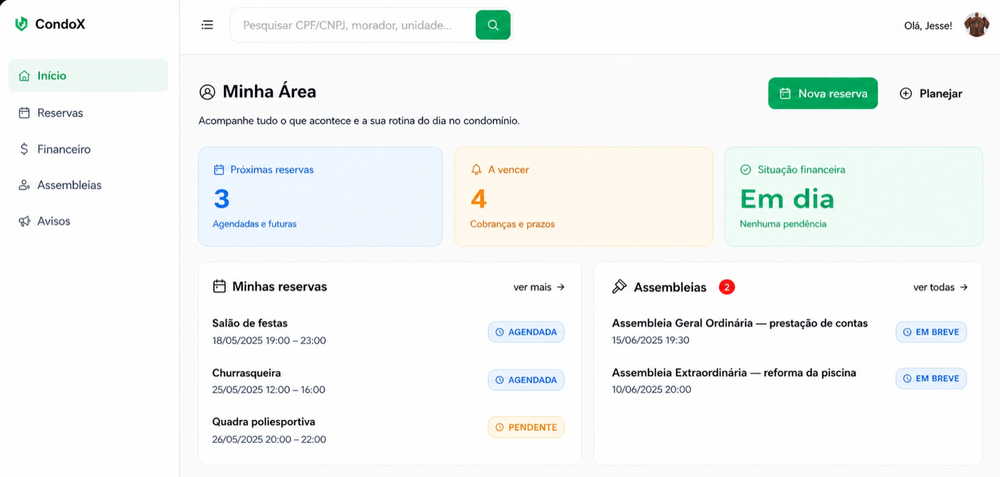

# 🏢 CondoX



Sistema de gestão para condomínios feito em **Django + Jazzmin**, com portal para moradores, área administrativa e integrações futuras com n8n.

## 🚀 Funcionalidades
- Área do morador: reservas, comunicados, eventos e assembleias
- Área do gestor: dashboard financeiro, inadimplência e controle de reservas
- Área do porteiro: agenda diária e controle de acesso
- Administração customizada com Jazzmin
- Upload de atas de assembleias
- Sistema de login com tela personalizada e recuperação de senha

## 🛠️ Tecnologias
- [Django 5](https://www.djangoproject.com/)
- [Django REST Framework](https://www.django-rest-framework.org/)
- [Jazzmin Admin](https://github.com/farridav/django-jazzmin)
- [Tailwind CSS](https://tailwindcss.com/)
- Deploy: Railway + Gunicorn + Whitenoise

## 💻 Como rodar localmente
```bash
# Clonar o repositório
git clone https://github.com/seu-usuario/condox.git
cd condox

# Criar ambiente virtual
python -m venv .venv
source .venv/bin/activate   # Mac/Linux
.venv\Scripts\activate      # Windows

# Instalar dependências
pip install -r requirements.txt

# Migrar banco de dados
python manage.py migrate

# Criar superusuário
python manage.py createsuperuser

# Rodar servidor
python manage.py runserver